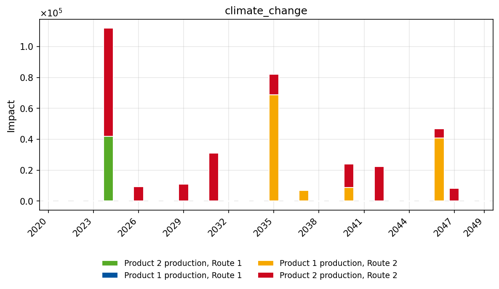
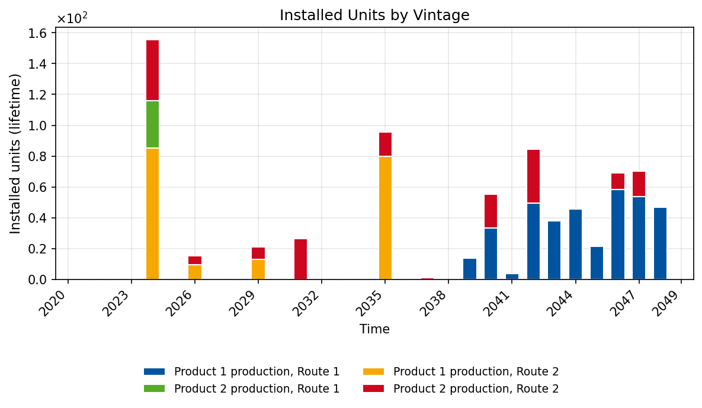
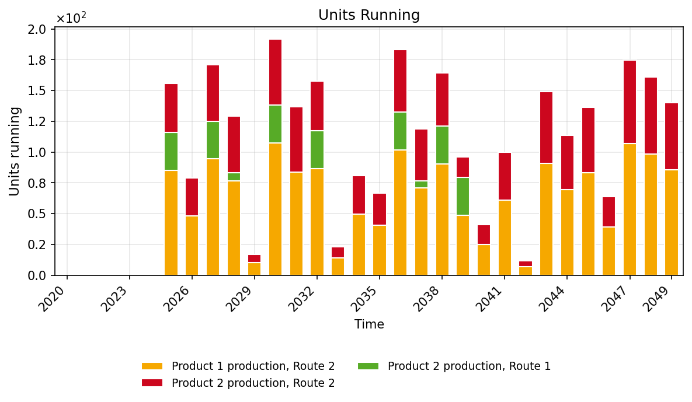
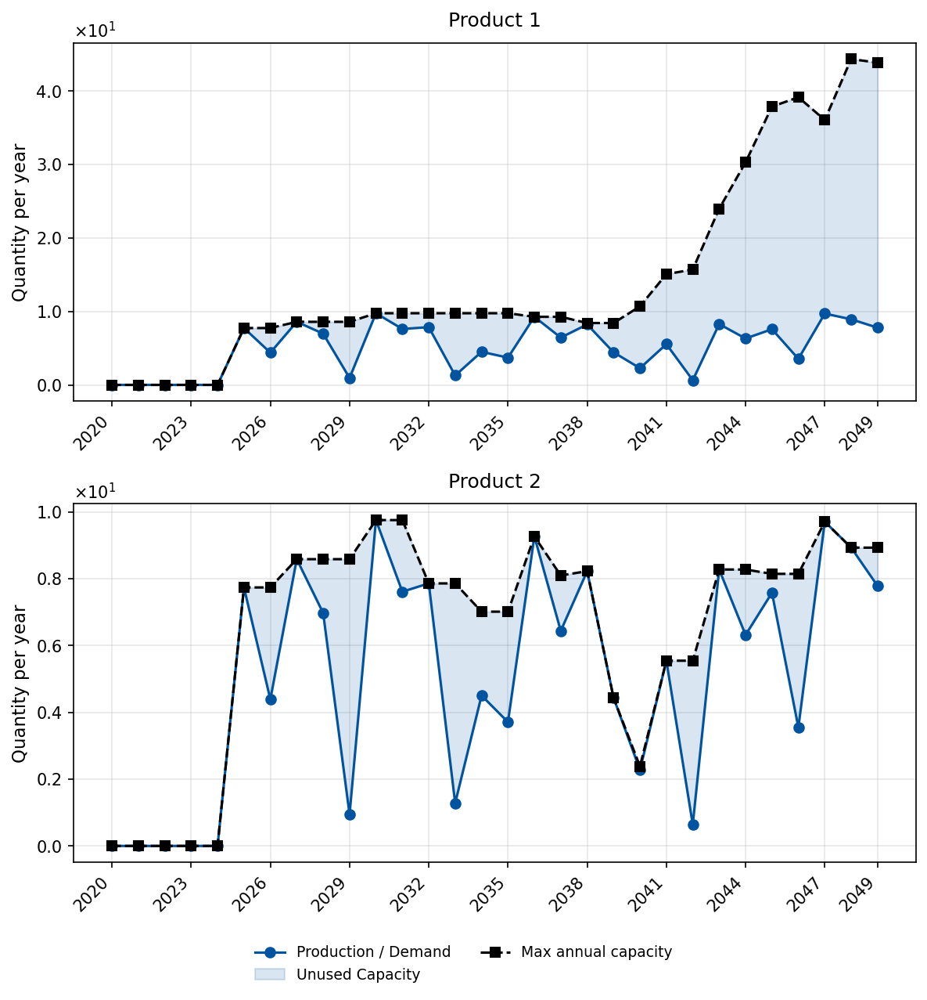

# Postprocessing Results

After solving an optimization model, `optimex` provides tools to extract, analyze, and visualize the results through the `PostProcessor` class. Results include installed process units per vintage, the units running per year, production volumes, time-resolved environmental impacts across all defined categories, and costs if prices are available.

---

## Creating a PostProcessor

```python
from optimex import postprocessing

# After solving
solved_model, objective, results = optimizer.solve_model(model, solver_name="glpk")

# Create postprocessor
pp = postprocessing.PostProcessor(solved_model)
```

The `PostProcessor` works the same for every [objective](choosing_objective/index.md): impacts in all categories, and costs if prices are available, are reported for any solved model.

---

## Extracting Data

### Environmental Impacts

Get impacts by process, category, and time:

```python
df_impacts = pp.get_impacts()
```

Returns a DataFrame with:
- **Index**: System time (years)
- **Columns**: MultiIndex of (Category, Process)
- **Values**: Impact in that category from that process at that time

```
Category    climate_change           land_use
Process     ProcessA    ProcessB     ProcessA    ProcessB
Time
2020        0.0         0.0          0.0         0.0
2021        150.5       0.0          25.0        0.0
2022        145.2       50.3         24.0        10.5
...
```

**Analyze specific aspects:**
```python
# Total impact per year
yearly_total = df_impacts.sum(axis=1)

# Total impact per process
process_total = df_impacts.sum(axis=0)

# Total impact in one category
climate_impacts = df_impacts["climate_change"].sum().sum()
```

<a id="costs"></a>

??? cost "Cost objective: costs, only with market prices"
    If the inputs carry market prices (see [Minimizing Costs](minimizing_costs.md)), get the cost of the background purchases by driver, process, and time:

    ```python
    df_costs = pp.get_costs()                    # undiscounted
    df_costs_pv = pp.get_costs(discounted=True)  # discounted to the reference year
    ```

    Returns a DataFrame with:
    - **Index**: System time (years)
    - **Columns**: MultiIndex of (Driver, Process), with driver `"installation"` (purchases scaling with installed units, e.g. construction) or `"operation"` (purchases scaling with the units running)
    - **Values**: Cost in the currency of the input prices

    ```python
    # Discounted total cost, equal to the objective of a cost-minimal model
    total_cost = df_costs_pv.sum().sum()

    # Operation-driven cost per year
    operation_costs = df_costs["operation"].sum(axis=1)
    ```

    Costs are also available for an impact-minimal model, so you can report what the environmentally optimal pathway costs. Without prices, the DataFrame has no columns.

---

### Installation (Capacity Deployment)

Get capacity installed by process and time:

```python
df_installation = pp.get_installation()
```

Returns a DataFrame with:
- **Index**: System time (years)
- **Columns**: Process IDs
- **Values**: Number of process **units** installed at that time

!!! warning "Installed units are a lifetime quantity"
    One installed unit delivers the production of its production exchange over its **whole lifetime** (the sum of its temporal distribution), spread across its operation window. These numbers are therefore not an annual capacity and must not be compared directly with production or demand. For the per-year quantity, use [`get_production_capacity()`](#production-capacity).

```
Process     ProcessA    ProcessB
Time
2020        10.0        0.0
2021        5.0         0.0
2022        0.0         15.0
...
```

**Common analyses:**
```python
# Total units installed per process
total_units = df_installation.sum()

# Cumulative units installed over time
cumulative = df_installation.cumsum()

# First year each process is installed (ignoring solver noise around zero);
# processes that are never installed show the first year, so check total_units
first_deployment = (df_installation > 1e-9).idxmax()
```

---

### Operation Levels

Get how many units of each process run per time period:

```python
df_operation = pp.get_operation()
```

Returns a DataFrame with:
- **Index**: System time (years)
- **Columns**: Process IDs
- **Values**: Number of units running in that year

```
Process     ProcessA    ProcessB
Time
2020        0.0         0.0
2021        10.0        0.0
2022        15.0        5.0
...
```

**Capacity utilization:**
```python
# Units running vs. units available: compare production against annual capacity
df_capacity = pp.get_production_capacity()   # per year
df_production = pp.get_production()          # per year
production_per_product = df_production.T.groupby(level="Product").sum().T
utilization = production_per_product / df_capacity
```

Do not divide `df_operation` by the cumulative sum of `df_installation`: units only run within their operation window, so a cumulative sum counts units that were never or are no longer available. `plot_utilization_heatmap()` does this correctly.

---

### Production Capacity

Get the maximum **annual** production available in each year:

```python
df_capacity = pp.get_production_capacity()
```

Returns a DataFrame with:
- **Index**: System time (years)
- **Columns**: Products
- **Values**: Output the installed and existing units could deliver in that year

This multiplies the units of every vintage that is in its operation phase by the output that vintage yields per unit and year, so it is directly comparable with `get_production()` and `get_demand()`.

---

### Production

Get production by process and product:

```python
df_production = pp.get_production()
```

Returns a DataFrame with:
- **Index**: System time (years)
- **Columns**: MultiIndex of (Process, Product)
- **Values**: Production amount

---

### Demand Fulfillment

Get demand values over time:

```python
df_demand = pp.get_demand()
```

Returns a DataFrame with:
- **Index**: System time (years)
- **Columns**: Products
- **Values**: Demand amount

**Verify demand is met:**
```python
total_production = df_production.T.groupby(level="Product").sum().T
demand_met = (total_production[df_demand.columns] >= df_demand - 1e-6).all().all()
```

---

## Visualization

The plot methods draw the figure with matplotlib and show it; they return nothing.
The examples below come from the [basic example](examples/basic_example.md).

**Customization:** layout and colors are set once for all plots via `plot_config`,
for example `figsize`, the font sizes, `colormap`, or a fixed `color_map` from
process or product code to color:

```python
pp = postprocessing.PostProcessor(
    solved_model,
    plot_config={"figsize": (8, 4), "legend_fontsize": 8},
)
```

To plot a subset, pass a filtered DataFrame from the matching `get_*()` method,
e.g. `pp.plot_impacts(df_impacts=pp.get_impacts()[["climate_change"]])`, and set
`annotated=False` to label processes by code instead of name.

### Impact Plot

Stacked bars of the impact per process and year, one panel per category:

```python
pp.plot_impacts()
```



---

### Installation Plot

Bar chart showing capacity deployment timeline:

```python
pp.plot_installation()
```



---

### Operation Plot

Shows how many units run over time:

```python
pp.plot_operation()
```



---

### Capacity Balance Plot

Compares actual production with the maximum annual capacity available:

```python
pp.plot_capacity_balance()
```



`detailed=True` additionally breaks the capacity down by process, and
`product=` restricts the plot to one product.

---

## Advanced Analysis

### Accessing Raw Model Data

For custom analysis, access the solved model directly:

```python
import pyomo.environ as pyo

# Get decision variable values: units installed per vintage, and units of each
# vintage running in a given year
for p in solved_model.PROCESS:
    for t in solved_model.SYSTEM_TIME:
        installation = pyo.value(solved_model.var_installation[p, t])
        print(f"{p}, installed in {t}: {installation:.2f} units")

for (p, v, t) in solved_model.ACTIVE_VINTAGE_TIME:
    operation = pyo.value(solved_model.var_operation[p, v, t])
    print(f"{p}, vintage {v}, year {t}: {operation:.2f} units running")

# Access expressions
for c in solved_model.CATEGORY:
    total = pyo.value(solved_model.total_impact[c])
    print(f"{c}: {total}")
```

### Dynamic Inventory

The time-resolved inventory of the optimal pathway, i.e. every elementary flow in every year, can be passed on to [dynamic_characterization](https://dynamic-characterization.readthedocs.io), e.g. to plot the radiative forcing over time:

```python
df_inventory = pp.get_dynamic_inventory(biosphere_database="biosphere3")
pp.plot_characterized_dynamic_inventory(
    base_lcia_method=("GWP", "100 years"),  # a method from bd.methods
    biosphere_database="biosphere3",
)
```

Pass the name of your biosphere database as `biosphere_database`; the default is `"ecoinvent-3.12-biosphere"`.

### Denormalization

`optimex` internally scales values for numerical stability. The `PostProcessor` automatically denormalizes, but for manual access:

```python
# Get scaling factors
fg_scale = solved_model.scales["foreground"]
cat_scales = solved_model.scales["characterization"]

# Denormalize a scaled value
scaled_value = pyo.value(solved_model.some_expression)
real_value = scaled_value * fg_scale * cat_scales["climate_change"]

# Cost expressions use the cost scale instead of a category scale
real_cost = pyo.value(solved_model.total_cost) * fg_scale * solved_model.scales["cost"]
```

---

## Exporting Results

### To CSV

```python
# Export all results
df_impacts.to_csv("impacts.csv")
df_installation.to_csv("installation.csv")
df_operation.to_csv("operation.csv")
```

### To Excel

Writing Excel files needs the `openpyxl` package (`pip install openpyxl`).

```python
import pandas as pd

with pd.ExcelWriter("results.xlsx") as writer:
    df_impacts.to_excel(writer, sheet_name="Impacts")
    df_installation.to_excel(writer, sheet_name="Installation")
    df_operation.to_excel(writer, sheet_name="Operation")
```

### Saving Figures

The plot methods show the figure instead of returning it. In a script, use a
non-interactive matplotlib backend, so the figure stays open after the call, and
save it with `plt.savefig()`:

```python
import matplotlib
matplotlib.use("Agg")  # before importing pyplot; draw without displaying
import matplotlib.pyplot as plt

pp.plot_impacts()
plt.savefig("impacts.png", dpi=300, bbox_inches="tight")
plt.savefig("impacts.pdf", bbox_inches="tight")
plt.close("all")
```

In a notebook, the displayed figure is closed once shown; save it from a script
as above, or plot the DataFrames from the `get_*()` methods yourself.

---

## Complete Postprocessing Example

```python
from optimex import postprocessing
import pandas as pd

# Create postprocessor
pp = postprocessing.PostProcessor(solved_model)

# Extract all data
df_impacts = pp.get_impacts()
df_installation = pp.get_installation()
df_operation = pp.get_operation()
df_production = pp.get_production()
df_demand = pp.get_demand()

# Summary statistics
print("=== Optimization Results ===")
print(f"Objective value: {objective:.2f}")
print(f"\nTotal impact by category:")
for cat in df_impacts.columns.get_level_values(0).unique():
    total = df_impacts[cat].sum().sum()
    print(f"  {cat}: {total:.2f}")

print(f"\nTotal units installed by process:")
for proc in df_installation.columns:
    total = df_installation[proc].sum()
    print(f"  {proc}: {total:.2f}")

# Show all plots
pp.plot_impacts()
pp.plot_installation()
pp.plot_capacity_balance()

# Save results
with pd.ExcelWriter("optimization_results.xlsx") as writer:
    df_impacts.to_excel(writer, sheet_name="Impacts")
    df_installation.to_excel(writer, sheet_name="Installation")
    df_operation.to_excel(writer, sheet_name="Operation")
```

---

## Comparing Scenarios

To compare scenarios that differ in their data, such as limits, prices, or
demand, solve them together with `optimizer.solve_series`. It returns one table
of objectives, impacts, costs, and installations, indexed by scenario:

```python
from optimex import optimizer, postprocessing

scenarios = {
    "baseline": model_inputs,
    "carbon_budget": model_inputs.model_copy(
        update={"cumulative_category_impact_limits": {"climate_change": 5.0e5}}
    ),
    "cheap_electricity": model_inputs.model_copy(
        update={"intermediate_flow_prices": {
            (flow, year): price * (0.5 if flow == "electricity" else 1.0)
            for (flow, year), price in model_inputs.intermediate_flow_prices.items()
        }}
    ),
}
results = optimizer.solve_series(
    scenarios, objective_category="climate_change", solver_name="highs",
    keep_models=True,  # to analyze each scenario with a PostProcessor
)

results.objective                          # one value per scenario
results.impacts                            # cumulative impact per category
results.installation.loc["carbon_budget"]  # installed units per year
pp = postprocessing.PostProcessor(results.models[1])  # full analysis of one scenario
```

With HiGHS or Gurobi, scenarios made with `model_inputs.model_copy(update=...)`
are assembled from one model instead of each being built from scratch, see
[Sweeps and Scenarios](series.md). Scenarios
that change the product system itself, e.g. other background databases, need
their own inputs and are solved one by one.

---

## Next Steps

- [Trade-offs](trade_offs.md): Compare the results of a series of models
- [Examples](examples/index.md): See complete worked examples
- [API Reference](../api/postprocessing.md): Full PostProcessor API documentation
