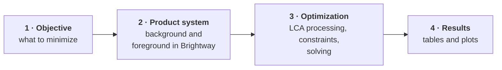

# Workflow Overview

Every `optimex` study runs through the same four steps, and the user guide is
organized along them:



| Step | What you do | Pages |
|---|---|---|
| **1 · [Choosing an Objective](choosing_objective/index.md)** | Decide what to minimize: an impact category (the default) or costs | [Minimizing Impacts](minimizing_impacts.md), [Minimizing Costs](minimizing_costs.md), [Trade-offs](trade_offs.md) |
| **2 · [Product System Modeling](product_system/index.md)** | Set up the Brightway project: time-specific background databases, LCIA methods, and the foreground processes with temporal information | [Background Data](background_data.md), [Foreground Modeling](foreground_modeling.md), optionally [Cost Modeling](cost_modeling.md) |
| **3 · [Optimization](optimization/index.md)** | Turn the product system into optimization inputs, add constraints, build and solve the model | [LCA Processing](lca_processing.md), [Constraints](constraints.md), [Solving](solving.md) |
| **4 · [Results](postprocessing.md)** | Extract and plot installations, operation, impacts, and costs | [Postprocessing](postprocessing.md) |

Step 2 and the LCA processing in step 3 are the expensive ones: building the
inventories of large background databases takes time. Once the optimization
inputs exist, constraints, solving, and results are fast, so you can save the
inputs and solve many variants from them.

---

## Environmental Studies First, Costs Optional

The guide describes the environmental workflow: minimizing impacts, possibly
under limits on other impacts. Most studies need nothing more, and all pages are
written for that case.

Minimizing costs builds on exactly the same workflow and adds three pieces:
market prices on the background nodes, one setting to read them, and
`objective="cost"` when building the model. Costs have two pages of their own:
[Cost Modeling](cost_modeling.md) for the price data (step 2) and
[Minimizing Costs](minimizing_costs.md) for the objective (step 1). Elsewhere,
the guide only points to them in collapsed boxes like this one, which you can
skip if you are not interested in costs:

??? cost "Cost objective"
    Boxes like this only matter for the cost objective.

| | Impacts only | With costs |
|---|---|---|
| Background databases with `representative_time` | Required | Required |
| LCIA method per impact category | Required | Required if impacts are limited or reported |
| Foreground processes with temporal distributions | Required | Required |
| Market prices on background nodes | — | [Required](cost_modeling.md#setting-market-prices) |
| `LCAConfig` | `characterization_methods` | plus [`price_attribute`](cost_modeling.md#reading-prices) |
| `create_model()` | `objective_category="..."` | `objective="cost"` |

Inputs with prices serve both objectives: an impact-minimal model still
[reports its costs](minimizing_impacts.md#costs-of-the-impact-minimum).

---

## Minimal Example

```python
from optimex import lca_processor, converter, optimizer, postprocessing

# 1  Objective: minimize climate change impacts
# 2  Product system: Brightway project with background and foreground databases

# 3  Optimization: LCA processing, constraints, solving
config = lca_processor.LCAConfig(demand=..., temporal=..., characterization_methods=...)
lca_data = lca_processor.LCADataProcessor(config)
manager = converter.ModelInputManager()
model_inputs = manager.parse_from_lca_processor(lca_data)
model_inputs = manager.override(cumulative_category_impact_limits={"climate_change": 1e6})

model = optimizer.create_model(model_inputs, name="study", objective_category="climate_change")
solved, objective_value, results = optimizer.solve_model(model, solver_name="glpk")

# 4  Results
pp = postprocessing.PostProcessor(solved)
pp.plot_installation()
```

The [Quick Start](quickstart.md) fills in the dots, and the
[Examples](examples/index.md) show complete studies.
