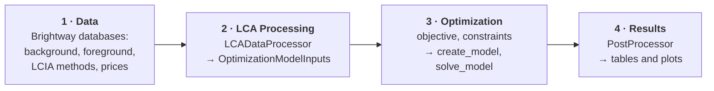

# Workflow

Every `optimex` study runs through the same four steps. The user guide follows
them, one page per task.



| Step | What you do | Pages |
|---|---|---|
| **1 · Data** | Set up the Brightway project: time-specific background databases, the foreground processes with temporal information, LCIA methods, and, for the cost objective, market prices | [Background Data](background_data.md), [Foreground Modeling](foreground_modeling.md) |
| **2 · LCA Processing** | Define the demand, configure the time-explicit LCA, and turn it into optimization inputs, which can be saved and reloaded | [LCA Processing](lca_processing.md) |
| **3 · Optimization** | Pick the objective, add constraints, build and solve the model | [Minimizing Impacts](minimizing_impacts.md), [Minimizing Costs](minimizing_costs.md), [Constraints](constraints.md), [Trade-offs](trade_offs.md), [Solving](solving.md) |
| **4 · Results** | Extract and plot installations, operation, impacts, and costs | [Postprocessing](postprocessing.md) |

Steps 1 and 2 are the expensive ones: building the inventories of large
background databases takes time. Once the optimization inputs exist, step 3 is
fast, so you can save the inputs and solve many variants (objectives,
constraints, scenarios) from them.

---

## Decide the Objective First

What you minimize decides which data step 1 has to provide, so settle it before
modeling. See [Choosing an Objective](choosing_objective.md).

| | Minimize impacts | Minimize costs |
|---|---|---|
| Background databases with `representative_time` | Required | Required |
| Foreground processes with temporal distributions | Required | Required |
| LCIA method per impact category | Required | Required if impacts are limited or reported |
| Market prices on background nodes | Not needed | Required, see [Market Prices](background_data.md#market-prices) |
| `LCAConfig` | `characterization_methods` | plus `price_attribute` |
| `create_model()` | `objective_category="..."` | `objective="cost"` |

Both objectives share everything else: the same model inputs, constraints,
and results. One set of inputs with prices serves both.

---

## Minimal Example

```python
from optimex import lca_processor, converter, optimizer, postprocessing

# 1 · Data: Brightway project with background and foreground databases
# 2 · LCA processing
config = lca_processor.LCAConfig(demand=..., temporal=..., characterization_methods=...)
lca_data = lca_processor.LCADataProcessor(config)
manager = converter.ModelInputManager()
model_inputs = manager.parse_from_lca_processor(lca_data)

# 3 · Optimization
model = optimizer.create_model(model_inputs, name="study", objective_category="climate_change")
solved, objective_value, results = optimizer.solve_model(model, solver_name="glpk")

# 4 · Results
pp = postprocessing.PostProcessor(solved)
pp.plot_installation()
```

The [Quick Start](quickstart.md) fills in the dots, and the
[Examples](examples/index.md) show complete studies.
