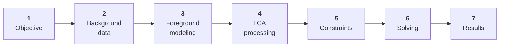

# Workflow

Every `optimex` study runs through the same seven steps. The user guide follows
them, one page per step.



| Step | What you do | Main tools |
|---|---|---|
| **1 · [Choosing an Objective](../choosing_objective/index.md)** | Decide what to minimize: an impact category or costs. This decides which data the next steps need. | `objective`, `objective_category` |
| **2 · [Background Data](../background_data.md)** | Set up the Brightway project: biosphere, time-specific background databases, LCIA methods, and, for costs, market prices | `bw2data`, `set_market_prices()` |
| **3 · [Foreground Modeling](../foreground_modeling.md)** | Model the candidate processes with temporal distributions, operation flags, and vintage parameters | `bw2data`, `TemporalDistribution` |
| **4 · [LCA Processing](../lca_processing.md)** | Define the demand, configure the time-explicit LCA, and build the optimization inputs, which can be saved and reloaded | `LCAConfig`, `LCADataProcessor`, `ModelInputManager` |
| **5 · [Constraints](../constraints.md)** | Add deployment limits, impact budgets, existing capacity, and more | `ModelInputManager.override()` |
| **6 · [Solving](../solving.md)** | Build the model for the objective and solve it | `create_model()`, `solve_model()` |
| **7 · [Results](../postprocessing.md)** | Extract and plot installations, operation, impacts, and costs | `PostProcessor` |

Steps 2 to 4 are the expensive ones: building the inventories of large
background databases takes time. Once the optimization inputs exist, steps 5 to
7 are fast, so you can save the inputs and solve many variants from them:
different objectives, constraints, or a whole [trade-off](../trade_offs.md) sweep.

---

## What Each Objective Needs

What you minimize decides which data steps 2 to 4 have to provide, which is why
the objective comes first:

| | Minimize impacts | Minimize costs |
|---|---|---|
| Background databases with `representative_time` (step 2) | Required | Required |
| LCIA method per impact category (step 2) | Required | Required if impacts are limited or reported |
| Market prices on background nodes (step 2) | Not needed | Required, see [Market Prices](../background_data.md#market-prices) |
| Foreground processes with temporal distributions (step 3) | Required | Required |
| `LCAConfig` (step 4) | `characterization_methods` | plus `price_attribute` |
| `create_model()` (step 6) | `objective_category="..."` | `objective="cost"` |

Both objectives share everything else: the same model inputs, constraints, and
results. One set of inputs with prices serves both, and an impact-minimal model
still [reports its costs](../minimizing_impacts.md#costs-of-the-impact-minimum).

---

## Minimal Example

```python
from optimex import lca_processor, converter, optimizer, postprocessing

# 1  Objective: minimize climate change impacts
# 2–3  Data: Brightway project with background and foreground databases

# 4  LCA processing
config = lca_processor.LCAConfig(demand=..., temporal=..., characterization_methods=...)
lca_data = lca_processor.LCADataProcessor(config)
manager = converter.ModelInputManager()
model_inputs = manager.parse_from_lca_processor(lca_data)

# 5  Constraints
model_inputs = manager.override(cumulative_category_impact_limits={"climate_change": 1e6})

# 6  Solving
model = optimizer.create_model(model_inputs, name="study", objective_category="climate_change")
solved, objective_value, results = optimizer.solve_model(model, solver_name="glpk")

# 7  Results
pp = postprocessing.PostProcessor(solved)
pp.plot_installation()
```

The [Quick Start](../quickstart.md) fills in the dots, and the
[Examples](../examples/index.md) show complete studies.
